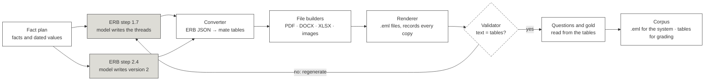
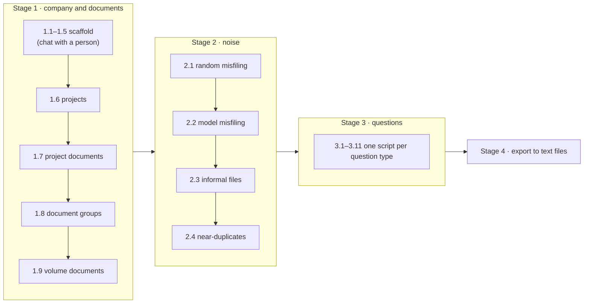
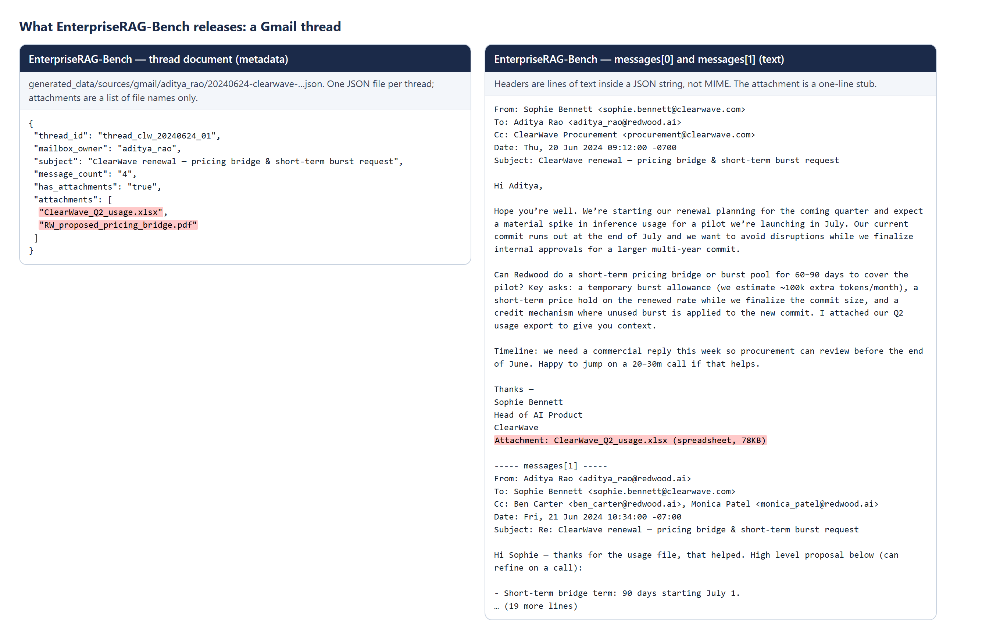
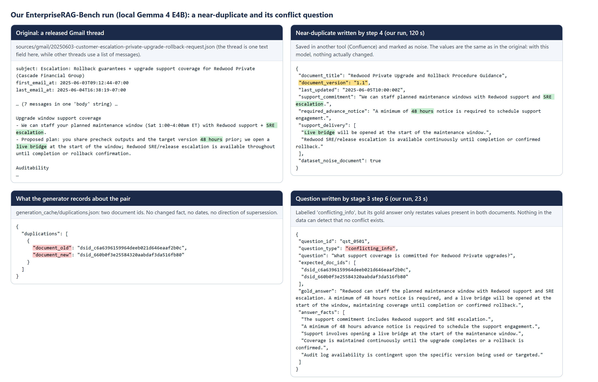
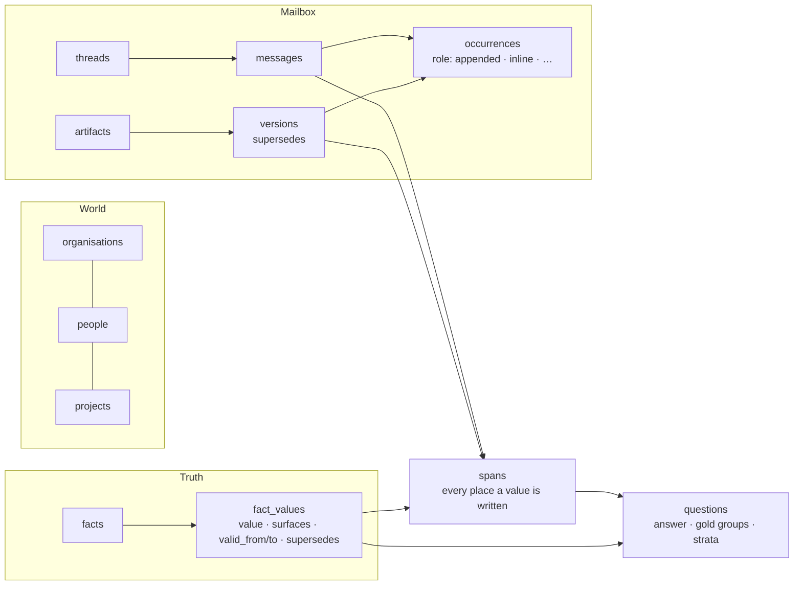

# Enterprise RAG Bench

**Generating an enterprise e-mail test corpus with real attachments, document versions and known answers.**

This repository holds the generation side of objective O1 of the master's project (PFE)
*Multimodal RAG for Enterprise Email and Attachments*, ESI Algiers × TH Deggendorf. It contains

- **EnterpriseRAG-Bench (ERB)**, the published corpus generator named in the project proposal,
  with a small model adapter of ours that lets it run on local or self-hosted models;
- **`mate`**, our own Python package, which turns planned facts into real `.eml` mailboxes and
  attachment files, records where every value is written, checks the result and grades answers;
- **an experiment** on ERB's handling of document updates, with its inputs, logs, outputs and a
  script that repeats it.

The README explains why each part exists, how it works, what we observed, and how the parts are
combined into the pipeline that will produce the test corpus.

> Research code, work in progress (November 2026). All people, companies and addresses in the
> generated data are fictional; generated addresses use the reserved `.example` domain (RFC 2606).

---

## Contents

1. [Motivation](#1-motivation)
2. [Repository layout](#2-repository-layout)
3. [Approach: the tables decide, the model writes, the code checks](#3-approach-the-tables-decide-the-model-writes-the-code-checks)
4. [Choice of the generator](#4-choice-of-the-generator)
5. [EnterpriseRAG-Bench](#5-enterpriserag-bench)
6. [Experiment: controlled updates in ERB](#6-experiment-controlled-updates-in-erb)
7. [`mate`: corpus, renderer, checks and grading](#7-mate-corpus-renderer-checks-and-grading)
8. [The generation pipeline under construction](#8-the-generation-pipeline-under-construction)
9. [Why RAGAS is not used to build the test set](#9-why-ragas-is-not-used-to-build-the-test-set)
10. [Use of the corpus in the thesis](#10-use-of-the-corpus-in-the-thesis)
11. [Getting started](#11-getting-started)
12. [Licences and data](#12-licences-and-data)
13. [References](#13-references)

---

## 1. Motivation

The thesis evaluates retrieval-augmented generation (RAG) over enterprise e-mail with attachments.
Three research questions drive the work:

| | Research question | What must be measured |
|---|---|---|
| **RQ1** | Duplicates and outdated versions | Does the system give the current value, or a value that has been replaced? |
| **RQ2** | Attachments placed inline or appended | Is an attachment found equally well in both placements, and from the e-mail to the file and back? |
| **RQ3** | Images | Are values that exist only in a chart, a screenshot or a scan found? |

Each question is answered by measurement. For every test question we must therefore know, before
the system is run, **the correct answer, the outdated answers, and every place in the mailbox where
the evidence is written**, so that retrieval and answers can be scored automatically.

No existing data set offers this. A company mailbox carries no such labels and can only be analysed
on site; published benchmarks have no attachments as files, no document versions and no
inline/appended distinction. The project therefore generates a synthetic but realistic test corpus.
A language model writes the text; everything that defines the truth is planned beforehand.

**A small example.** A supplier sends offer HP-2041 for a pump at **48.370 €** on 11 January, then a
revised offer at **47.950 €** on 18 January. Because every reply quotes the earlier messages, the old
price ends up written in eight places across four e-mails. A question *"What is the current unit
price?"* has one correct answer (47.950 €), one outdated answer (48.370 €), and evidence in several
places. A system that answers 48.370 € has not made a random error: it has followed an outdated
version, which is exactly what RQ1 measures. The corpus must make this distinction visible.

## 2. Repository layout

```
Entreprise_RAG_Bench/
├── README.md                          this document
├── enterprise-rag-bench/              ERB at upstream commit d36685e (MIT) + our model adapter
│   ├── CHANGES.md                     exactly what we added and what we left out
│   ├── src/llm/chat_completions_llm.py   our adapter (new file)
│   ├── src/llm/factory.py             registers the adapter (8 added lines)
│   └── …                              upstream code, prompts, scaffold and documentation
├── mate/                              our package: data model, files, .eml renderer, checks, grading
│   ├── src/mate/                      the code (Python 3.11+)
│   ├── examples/seed/                 a hand-written mailbox: 11 messages, 15 questions
│   ├── schema/                        JSON Schemas exported from the data model
│   └── tests/                         26 tests
├── experiments/
│   └── 2026-11-14-erb-update-test/    inputs, logs, outputs and run.sh of the ERB experiment
└── docs/figures/                      figures used below
```

## 3. Approach: the tables decide, the model writes, the code checks

The corpus is built **facts first**. Everything that defines the truth is decided in tables before any
text exists: the facts, their values over time, the documents and their versions, which e-mail
carries which file, and in which role. A language model only writes the words around these values.
Code builds the attachment files and the `.eml` files, records every place a value appears
(including copies in quoted and forwarded history), and checks that the text says what the tables
say. Text that fails a check is regenerated; the tables are never changed to fit the text.



*Grey: written by a language model. White: decided or computed by code. Dashed: check.*

Two consequences follow. First, **the gold answer of a question is read, not written**: because the
values are planned and every copy is recorded by the renderer, no model is asked for the answer.
Second, **grading needs no judge model for value questions**: an answer is compared with the planned
current and outdated values. This is the same principle as CorporateBench [2], whose answers are
computed by queries on a knowledge base rather than written by a model.

## 4. Choice of the generator

### 4.1 What the generator must provide

| Need | Why the thesis needs it |
|---|---|
| **N1** Company e-mail threads | The system ingests a mailbox: senders, recipients, replies, forwards, quoted history |
| **N2** Real attachments | RQ2 compares inline and appended attachments; RQ3 needs images and scans |
| **N3** Controlled versions | RQ1 needs to know what changed, when, and which version is current |
| **N4** Known answers and evidence | Scoring must be automatic and must not depend on a model's opinion |
| **N5** Noise | A clean corpus makes retrieval too easy; RQ1 studies duplicates |
| **N6** Usable | The proposal asks for an existing generator; code must be released and runnable |

### 4.2 Candidates

From the studies included in our literature review we kept those that generate the documents of a
whole company with a language model and release a question-answering benchmark on them. Four meet
this condition.

| Generator | What it builds | How answers are made | Released |
|---|---|---|---|
| **EnterpriseRAG-Bench** [1] (Onyx, UC Berkeley, 2026) | A fictional AI company, about 500,000 documents in nine tools (120,000 Gmail threads), 500 questions of ten types | A model writes the gold answer; three judge models correct the gold documents | Code and data, MIT |
| **CorporateBench** [2] (Epiq AI Labs, Cornell, 2026) | A company as a knowledge graph simulated over 90 days; each e-mail written around an "evidence string" stating one fact | 250 templates, answers computed by SPARQL queries | Data; not the generator |
| **WinSyn** [3] (Microsoft Research India, 2026) | Seed document → organisation of up to 25 people → epics, tasks, daily logs → e-mails → questions | Questions from the planned artefacts; validators after each stage | Nothing |
| **HERB** [4] (Salesforce, EMNLP 2025 Industry) | Product workflows as documents, meetings, Slack and pull requests; 39,190 artefacts; 815 answerable and 699 unanswerable questions | Questions planned first, evidence generated for them | Data; not the generator |

### 4.3 Comparison

| | N1 threads | N2 attachments | N3 versions | N4 known gold | N5 noise | N6 usable |
|---|:-:|:-:|:-:|:-:|:-:|:-:|
| **ERB** | ✓ Gmail threads | ✗ file names only | ◐ pairs, change not controlled | ◐ written by a model | ✓ misfiling, duplicates | ✓ code, MIT |
| **CorporateBench** | ◐ few replies, no reply headers | ✗ | ✗ no contradictions by design | ✓ queries on the truth | ◐ | ✗ generator not released |
| **WinSyn** | ◐ `.eml`, threads not described | ✗ | ✗ | ✓ from the plan | ✓ distractors | ✗ nothing released |
| **HERB** | ✗ no e-mail | ✗ | ◐ versions not linked | ◐ evidence as a flat list | ✓ | ✗ generator not released |

✓ meets · ◐ partly · ✗ does not meet

### 4.4 Result

1. **Only ERB can be used**: the three other generators are not released.
2. **No candidate covers N2 and N3**: none produces attachments as files or controlled versions.
   Whatever the base, this part must be built by us; it is the contribution of the thesis to the
   corpus.
3. **The others still contribute rules**: from CorporateBench, answers computed from the truth; from
   WinSyn, "plan first, then write" and a validator after each step; from HERB, planning what each
   question type needs before any text is written, including facts deliberately left out for
   unanswerable questions.

## 5. EnterpriseRAG-Bench

### 5.1 The pipeline, step by step

ERB is a Python project with one script per step, in four stages. The scaffold of steps 1.1–1.5 is
written in an interactive chat with a person (the script waits at a `You:` prompt); every later step
runs on its own and is grounded in that scaffold.



| Step | What it does | In our pipeline |
|---|---|---|
| **1.1** Company overview | Name, products, customers, competitors, business model | Kept (or reuse ERB's released company) |
| **1.2** Initiatives | The company's main goals for the year | Kept |
| **1.3** Employee directory | People with titles, teams, managers and e-mail addresses; mailboxes come from it | Kept |
| **1.4** Source structure | The tools used (Gmail, Slack, Jira, Confluence, Google Drive, …) and their folders | Kept |
| **1.5** Writing rules (`agents.md`) | How documents of each tool look; for Gmail: one thread per file, quoted replies, attachments as stubs | **Changed**: real attachments, one record per message |
| **1.6** Projects | Projects with the people involved and the documents each one needs | Kept |
| **1.7** Project documents | Writes each document, aware of the company, the project and the documents already written | **Changed**: a block of planned values is added to the prompt |
| **1.8** Document groups | Groups of 4–10 documents whose answer needs all of them | Kept |
| **1.9** Volume documents | Thousands of extra everyday documents | Not used at our scale |
| **2.1** Random misfiling | Moves a small share of documents to a random wrong folder | Kept, logged |
| **2.2** Model misfiling | The model moves documents to a wrong but plausible folder | Kept, logged |
| **2.3** Informal files | Jokes, hackathon notes, chit-chat | Kept, logged |
| **2.4** Near-duplicates | Rewrites a document as a newer version where "some facts are updated"; records the pair | **Changed**: the change is planned (fact, old value, new value, date) |
| **3.1–3.11** Questions | Basic, semantic, intra-document, project, constrained, conflicting information, completeness, miscellaneous, high-level, information not found, metadata | Not used for our gold (§3) |
| **4** Export | Documents as text files in zip archives | Replaced by `mate`'s renderer |

### 5.2 Models supported by the code

All model calls in ERB go through `get_llm` and `get_cheap_llm`
([`factory.py`](enterprise-rag-bench/src/llm/factory.py)), which choose a back-end from the
environment variable `LLM_PROVIDER`. The released code accepts two values and rejects any other:

```python
# enterprise-rag-bench/src/llm/factory.py (upstream, line breaks condensed)
LLM_PROVIDER = os.environ.get("LLM_PROVIDER", "openai")
...
    if provider == "openai":
        return OpenAILLM(model=model, tools=tools, quiet=quiet, reasoning_level=reasoning_level)
    elif provider == "anthropic":
        return AnthropicLLM(model=model, tools=tools, quiet=quiet, reasoning_level=reasoning_level)
    else:
        raise ValueError(f"Unsupported LLM provider: {provider}. Supported providers: openai, anthropic")
```

Each back-end sets its default models and calls its provider's own API:

```python
# enterprise-rag-bench/src/llm/openai_llm.py
 13  LLM_MODEL_NAME = os.environ.get("LLM_MODEL_NAME", "gpt-5.4")
 14  CHEAP_LLM_MODEL_NAME = os.environ.get("CHEAP_LLM_MODEL_NAME", "gpt-5-mini")
112      stream = self.client.responses.create(**kwargs)          # OpenAI Responses API

# enterprise-rag-bench/src/llm/anthropic_llm.py
 13  LLM_MODEL_NAME = os.environ.get("LLM_MODEL_NAME", "claude-sonnet-4-6")
 14  CHEAP_LLM_MODEL_NAME = os.environ.get("CHEAP_LLM_MODEL_NAME", "claude-haiku-4-5")
165      budget_tokens_map = {"low": 2000, "medium": 5000, "high": 10000}   # extended thinking
177      with self.client.messages.stream(**kwargs) as stream:     # Anthropic Messages API
```

| `LLM_PROVIDER` | API called | Main model (default) | Cheap model (default) |
|---|---|---|---|
| `openai` | OpenAI Responses API | `gpt-5.4` | `gpt-5-mini` |
| `anthropic` | Anthropic Messages API | `claude-sonnet-4-6` | `claude-haiku-4-5` |
| `chat` (ours) | Chat Completions API | set by `LLM_MODEL_NAME` | `CHEAP_LLM_MODEL_NAME`, or the main model |

Running ERB as released therefore requires a paid OpenAI or Anthropic account.

### 5.3 Our adapter

**Why.** We had no paid API, so ERB had to run on a model we could serve ourselves. A local server
such as Ollama is reached through the Chat Completions API, the format shared by OpenAI-compatible
servers, whereas ERB's OpenAI back-end is written for the Responses API. We also wanted to change the
model later without touching ERB's prompts or steps, so that our runs stay comparable with the
published generator.

**How.** ERB's steps never call a provider directly; they call one method, `generate`, of the
interface `LLMInterface`. We added one class that implements this method for the Chat Completions
API and registered it as a third provider:

- [`chat_completions_llm.py`](enterprise-rag-bench/src/llm/chat_completions_llm.py), a new file of
  102 lines, converts ERB's messages, tool definitions, tool calls and tool results to the Chat
  Completions format and back;
- four lines in `get_llm` and four in `get_cheap_llm` register it as `LLM_PROVIDER=chat`;
- nothing else in ERB was changed ([`CHANGES.md`](enterprise-rag-bench/CHANGES.md)).

```python
# enterprise-rag-bench/src/llm/chat_completions_llm.py (excerpt)
 43  self.client = OpenAI(api_key=api_key or LLM_API_KEY, base_url=CHAT_BASE_URL, timeout=CHAT_TIMEOUT)

 85  def generate(self, messages: list[Message]) -> Generator[str | ToolCall, None, None]:
 88      kwargs = {"model": self.model, "messages": self._build_messages(messages)}
 89      if self.tools:
 90          kwargs["tools"] = self.tools
 91      resp = self.client.chat.completions.create(**kwargs)
 92      choice = resp.choices[0].message
 93      if choice.content:
 94          yield choice.content
 95      for tc in choice.tool_calls or []:
 97          args = json.loads(tc.function.arguments) if tc.function.arguments else {}
102          yield ToolCall(name=tc.function.name, args=args, call_id=tc.id or f"call_{uuid.uuid4().hex[:12]}")
```

### 5.4 What ERB lacks for this thesis

ERB is strong where it matters for realism (a coherent company, projects, noise), but three
properties we need are absent. Each is visible in its code.

**Attachments are file names.** The Gmail rules tell the model to write attachments as one-line
stubs ([`agents.md`, line 26](enterprise-rag-bench/generated_data/sources/gmail/agents.md#L26)):

```text
- Attachments are referenced frequently; represent as short attachment stubs (filename/type) rather
  than generating full binary content.
```

In the released data, a message ends with a line such as `Attachment: ClearWave_Q2_usage.xlsx
(spreadsheet, 78KB)`, and the thread is one JSON file whose headers are lines of text, not an e-mail
file that a mail system can ingest.



**Updates are not controlled.** Step 2.4 asks the model to rewrite a document so that "some facts
are updated" ([`new_duplicate_file.py`, line 48](enterprise-rag-bench/src/prompts/new_duplicate_file.py#L48)).
Which fact changes, its old and new values and the date are left to the model, and the only record
kept is the pair of document identifiers.

**Gold answers are written by a model.** Each question step gives documents to a model and asks for a
question, "a corresponding gold answer" and a list of statements
([`conflicting_query.py`](enterprise-rag-bench/src/prompts/conflicting_query.py#L3-L6)); the model
decides which document is the update. ERB's authors describe the resulting gold as "revisable
hypotheses rather than fixed ground truth" [1]. For RQ1 this is not acceptable: the model can make
the very error we want to measure, and it does not know the copies of a value in quoted history.

## 6. Experiment: controlled updates in ERB

Folder: [`experiments/2026-11-14-erb-update-test/`](experiments/2026-11-14-erb-update-test/README.md).

**Question.** Can ERB's two update-related steps, 2.4 (near-duplicate) and 3.6 (conflicting-information
question), be relied on to build the test material of RQ1?

**Set-up.** ERB with our adapter; Gemma 4 E4B served by Ollama on a laptop GPU (6 GB), context
16,384 tokens; two Gmail threads of ERB's released company; one near-duplicate and one question.

**Observations (14 November 2026).**

| Step | Time | What happened |
|---|---|---|
| 2.4 near-duplicate | 120 s | First output rejected by ERB's check `validate_no_nested_dicts`; second accepted. The new version of the Gmail thread was written as a Confluence page; ERB recorded only the two document identifiers |
| 3.6 conflicting question | 23 s | Question `qst_0501`, labelled `conflicting_info` |

The near-duplicate states the same commitments as the original (48 hours of notice, a live bridge,
SRE escalation, restoration in tens of minutes, the N-1 upgrade path); no fact was changed. The
question's gold answer restates these common values, although the question is labelled as a
conflict. ERB cannot detect this, because it never records which fact was meant to change.



**Repetition (17 November 2026)** with [`run.sh`](experiments/2026-11-14-erb-update-test/run.sh):
the first output was again rejected for nested JSON; this time the model changed one detail (an
optional rollback drill became "a mandatory prerequisite"), but ERB again recorded only the two
identifiers, so the change is found only by reading both documents.

**Interpretation.** The adapter works with ERB's real steps. The small model breaks ERB's format rule
and is not suitable for the corpus. Independently of the model, ERB neither controls nor records
updates and lets a model write the gold answer; therefore the test material of RQ1 is planned in
tables and its gold is read from them (§3).

## 7. `mate`: corpus, renderer, checks and grading

### 7.1 Why `mate` exists

ERB writes text. The thesis also needs a real mailbox that a RAG system can ingest, an answer key
that is complete by construction, and a grader that recognises an outdated answer. No existing tool
provides these, so we wrote them. The name stands for *Messages, Attachments, Threads and Evidence*
(working name).

| The thesis needs | ERB provides | `mate` provides |
|---|---|---|
| Real `.eml` files | Text inside JSON | RFC 5322 / MIME rendering with headers, quoted history, inline and appended parts |
| Real attachments | File names | Reproducible PDF, DOCX, XLSX, charts and degraded scans |
| Every place a value is written | — | Evidence records, including copies created by quoting and forwarding |
| Grading of outdated answers | A judge model | Value comparison: correct, superseded, partial, abstain, wrong |

### 7.2 Data model

The truth is a set of JSON Lines tables. The system under test sees only the rendered `.eml` files.



| Module | Lines | What it does |
|---|--:|---|
| [`schema.py`](mate/src/mate/schema.py) | 609 | Data model: company, facts and their values over time, documents and versions, messages, attachments, evidence, questions, run records |
| [`validate.py`](mate/src/mate/validate.py) | 380 | Checks V01–V12 on the tables and V20–V21 on the rendered mail |
| [`render_eml.py`](mate/src/mate/render_eml.py) | 298 | Deterministic `.eml` rendering; records every copy of a value |
| [`metrics.py`](mate/src/mate/metrics.py) | 239 | Retrieval against evidence groups, answer grading, citation scores |
| [`filebuilders.py`](mate/src/mate/filebuilders.py) | 222 | Reproducible PDF, DOCX, XLSX, charts and degraded scans |
| [`normalize.py`](mate/src/mate/normalize.py) | 130 | Matches values written differently in German and English (`47.950 €` = `EUR 47,950.00`) |
| [`corpus.py`](mate/src/mate/corpus.py), [`cli.py`](mate/src/mate/cli.py) | 187 | Tables in and out; `mate validate`, `mate render`, `mate schema` |

### 7.3 The parts on which the gold depends

**A value with its period of validity** ([`schema.py`, lines 140–151](mate/src/mate/schema.py#L140-L151)):

```python
class FactValue(Model):
    id: FactValueId
    fact_id: FactId
    value: str | int | float | bool  # canonical: decimal string with unit, ISO date, ...
    surfaces: dict[Lang, list[str]]  # how the value is written, per language
    valid_from: AwareDatetime
    valid_to: AwareDatetime | None = None  # set when a later value supersedes this one
    supersedes: FactValueId | None = None
    standing: Standing = Standing.valid
    asserted_by: PersonId | None = None
```

**Every copy is recorded when a reply quotes or forwards an earlier message**
([`render_eml.py`, lines 237–262](mate/src/mate/render_eml.py#L237-L262), excerpt):

```python
for span in self.c.spans:
    ...
    if span.anchor not in history:
        continue
    out.append(Span(
        id=f"{span.id}-in-{suffix}",
        fact_value_id=span.fact_value_id,
        location={"kind": kind, "message_id": msg.id},
        anchor=span.anchor,
        origin=origin,                    # quoted or forwarded
        copy_of=span.copy_of or span.id,
        derived=True,
    ))
```

**Answers are graded without a judge model**
([`metrics.py`, lines 163–186](mate/src/mate/metrics.py#L163-L186), excerpt). An answer that gives
only an outdated value is graded `superseded`, the measure of RQ1:

```python
found = [a for a in q.answer.accepted if contains_value(answer, a)]
stale = [s for s in q.answer.superseded if contains_value(answer, s)]
if found and not stale:
    return "correct"
if stale and not found:
    return "superseded"
if found and stale:
    return "partial"  # both values given: hedged, right only if it says which is current
return "abstain" if _ABSTAIN.search(answer) else "wrong"
```

**Every recorded place must really appear in the rendered e-mail**
([`validate.py`, lines 337–342](mate/src/mate/validate.py#L337-L342)):

```python
for s in c.spans:
    loc = s.location
    if loc.message_id and loc.kind in ("body", "quoted_body", "forwarded_body"):
        text = index.get(loc.message_id, {}).get("text", "")
        if s.anchor not in text:
            r.error("V21", f"{s.id} anchor {s.anchor!r} is not in the rendered text of {loc.message_id}")
```

### 7.4 The seed corpus

[`mate/examples/seed/`](mate/examples/seed/) is a mailbox written by hand to exercise every part of
the data model: three organisations, 11 messages, 43 evidence records and 15 questions of 13 types
(current value, value at a past date, value history, contested values, e-mail-to-attachment and back,
image facts, counting, metadata, unanswerable, thread summary, …). Its first question:

```json
{
  "id": "q-001", "type": "current_value", "scope": "current",
  "text": "What is the current unit price of a P-200 pump in Hydrova's offer HP-2041?",
  "answer": {
    "kind": "value",
    "reference_text": "€47,950 per pump (revision of 18 January 2027).",
    "accepted":   ["€47,950", "47.950 €"],
    "superseded": ["€48,370", "48.370 €"],
    "fact_value_ids": ["fv-price-v2"]
  },
  "gold": {"groups": [{"fact_value_id": "fv-price-v2",
                       "span_ids": ["spn-006", "spn-023", "spn-006-in-04"], "required": true}]}
}
```

`spn-006` is the new price in the body of message 03, `spn-023` the same price in the table of the
revised offer (PDF), and `spn-006-in-04` a copy recorded by the renderer, because message 04 forwards
message 03. Retrieving any span of the group counts as finding the value.

The corpus builds, renders and validates, and the 26 tests pass.

## 8. The generation pipeline under construction

### 8.1 Components to write

| Component | Why | How |
|---|---|---|
| Fact-plan loader | Values must exist before text | Reads facts and dated values per project; writes the fact block of the prompts |
| Step 1.7 hook (ERB) | Exact values; one record per message | Gmail rules v2; fact block added to the prompt |
| Step 2.4 hook (ERB) | Controlled versions | The planned change replaces "some facts are updated"; the change is recorded |
| Converter | ERB output is JSON text, not our tables | Threads and duplicate pairs become messages, versions, files and attachments |
| Attachment text | Files need content | A model writes text from an outline with the planned values; the file builders make the file |
| Question builder | Gold from the tables | One template per question type, filled from the tables; a model rewords the question |
| Platform runner | Baseline and experiments | Sends each question to the system under test, stores passages and answer, scores them |

### 8.2 Prompt changes (drafts)

<details>
<summary><b>Fact block added to the step 1.7 prompt</b></summary>

```text
## Facts this thread must state
These values are fixed. Write each one exactly as given, in the message named, inside a natural
sentence. Do not state any other price, date or quantity, and do not round or reformat the values.
- msg-03 (supplier to buyer, 2027-01-18, German): unit price of pump P-200 in offer HP-2041
  = "47.950 €" (replaces "48.370 €"); one sentence must say that the attached offer replaces
  the version of 11 January.
Attach offer HP-2041, version v2, to msg-03 (role: appended).
```
</details>

<details>
<summary><b>Planned change replacing "however some facts are updated" in step 2.4</b></summary>

```text
Change exactly the following fact and keep every other value of the original unchanged:
  fact:      unit price of pump P-200 in offer HP-2041
  old value: "48.370 €"    new value: "47.950 €"    valid from: 2027-01-18
Write the new value exactly as given. If the document has a date or "last updated" field,
set it to 2027-01-18.
```
</details>

<details>
<summary><b>Gmail rules v2, replacing the attachment rule</b></summary>

```text
- Each document is one thread. Put its messages in the list "messages", oldest first.
  Each message has: key (m1, m2, ...), kind (new | reply | reply_all | forward | resend),
  in_reply_to (a key, or ""), from, to, cc, sent_at (ISO 8601 with offset),
  subject as sent (with Re:/AW: or Fwd:/WG:), language (en | de), body.
- "body" holds only the text the sender writes. Never copy an earlier message into it:
  quoted history and forwarded headers are added when the thread is rendered.
- Attachments are real files. For each file a message carries, add an entry to "attachments":
  message key, file name as sent, kind (offer | order | invoice | contract | report | ...),
  version label as people write it (v1, Rev. B, final), role (appended | inline),
  and an outline of its sections.
```
</details>

### 8.3 Planned sequence for one project

```bash
# model back-end (exists)
export LLM_PROVIDER=chat CHAT_BASE_URL=... LLM_API_KEY=... LLM_MODEL_NAME=...
# 1 company and people: reuse ERB's scaffold, or ERB steps 1.1–1.6         (exists)
# 2 fact plan of the project                                               (to write)
python -m mate.factplan plans/pumpstation-nord.yaml
# 3 thread text with the planned values: ERB step 1.7 with our hook        (hook to write)
python -m src.scripts.data_gen_stage_1_generate_clean_data.step_7_generate_project_documents
# 4 new versions with the planned change: ERB step 2.4 with our hook       (hook to write)
python -m src.scripts.data_gen_stage_2_add_noise.step_4_generate_near_duplicates
# 5 convert to mate tables and build the attachment files                  (to write)
python -m mate.erb_import generated_data/ corpus/
# 6 render the .eml files, record every copy, check                        (exists)
mate render corpus/
mate validate corpus/
# 7 questions and gold from the tables                                     (to write)
python -m mate.questions corpus/
```

## 9. Why RAGAS is not used to build the test set

The proposal mentions RAGAS-style question synthesis. RAGAS [5] defines answer metrics scored by a
judge model (faithfulness, answer relevance, context relevance); its library also contains a
test-set generator that splits a finished corpus into chunks and asks a model to write a question, a
reference answer and the reference contexts from a few chunks, with varied personas and query
styles. We do not use this generator for the test set:

1. **Incomplete evidence.** The reference contexts are only the chunks the model read; copies of a
   value in quoted and forwarded history would count as misses.
2. **No notion of time.** The model does not know which value is current at the question's date and
   may write the outdated value as the reference answer, the very error RQ1 measures.
3. **No attachments.** RAGAS has no notion of an attachment, its role, or the link between an e-mail
   and its file, so it cannot produce the questions of RQ2.

What we keep from "RAGAS-style" synthesis is varied wording: each question built from the tables is
reworded by a model in several styles (indirect, verbose, formal, keyword, colloquial).

## 10. Use of the corpus in the thesis

| Part of the thesis | What it uses |
|---|---|
| Method (O1) | This pipeline; the manifest records generator, model, prompts and seed, so the corpus can be rebuilt |
| Baseline | The `.eml` files ingested as they are; every question sent to the system; passages matched to the evidence; answers graded |
| RQ1 | Share of outdated answers, from the planned versions and their outdated values |
| RQ2 | Retrieval split by attachment role and by direction (e-mail → file, file → e-mail) |
| RQ3 | Retrieval split by file type: born-digital, scan, chart, screenshot |
| Calibration | The figures assumed in the corpus (share of e-mails with attachments, file types) compared with the real mailbox |

## 11. Getting started

**`mate`** (Python 3.11 or later):

```bash
cd mate
pip install -e ".[files,dev]"
python -m pytest -q                    # 26 tests
python examples/seed/build_seed.py     # build, render and validate the seed corpus
mate validate examples/seed/corpus
```

**ERB with a local model** (Ollama):

```bash
cd enterprise-rag-bench
pip install -r requirements.txt
export LLM_PROVIDER=chat CHAT_BASE_URL=http://localhost:11434/v1 LLM_API_KEY=ollama
export LLM_MODEL_NAME=gemma4-16k       # a model with a context of at least 16k tokens
python -m src.scripts.data_gen_stage_2_add_noise.step_4_generate_near_duplicates --count 1
```

ERB's own [`quickstart.md`](enterprise-rag-bench/quickstart.md) describes every step and its
options. To repeat our experiment: `bash experiments/2026-11-14-erb-update-test/run.sh`.

## 12. Licences and data

- `enterprise-rag-bench/` is distributed under its original MIT licence
  ([`LICENSE`](enterprise-rag-bench/LICENSE), copyright DanswerAI, Inc.); our additions are listed in
  [`CHANGES.md`](enterprise-rag-bench/CHANGES.md). The released corpus of about 500,000 documents is
  not included; it is available from the upstream releases.
- `mate/` is project code; its licence (MIT for code, CC BY 4.0 for data) is still to be confirmed.
- The experiment inputs are two released ERB documents (MIT); all generated people, companies and
  addresses are fictional.

## 13. References

1. Sun, Y. et al. (2026). *EnterpriseRAG-Bench: A RAG Benchmark for Company Internal Knowledge.*
   arXiv:2605.05253. Code: [onyx-dot-app/EnterpriseRAG-Bench](https://github.com/onyx-dot-app/EnterpriseRAG-Bench).
2. Hamilton, S. et al. (2026). *CorporateBench: Large-Scale Q&A Benchmarking with Temporal Knowledge
   Bases.* arXiv:2608.27391.
3. Varhade, A. et al. (2026). *WinSyn: An Automated Pipeline for Realistic Enterprise
   Question-Answering Evaluation.* arXiv:2609.12171.
4. Choubey, P. K. et al. (2025). *Benchmarking Deep Search over Heterogeneous Enterprise Data (HERB).*
   EMNLP 2025, Industry Track.
5. Es, S., James, J., Espinosa-Anke, L. and Schockaert, S. (2024). *RAGAS: Automated Evaluation of
   Retrieval Augmented Generation.* EACL 2024, System Demonstrations.
